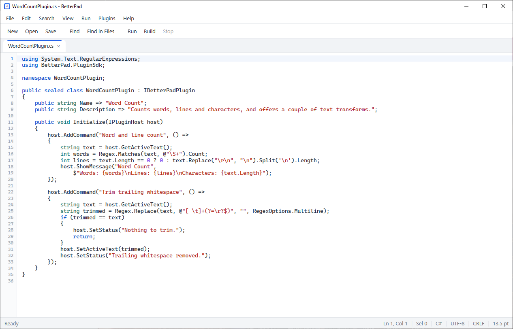
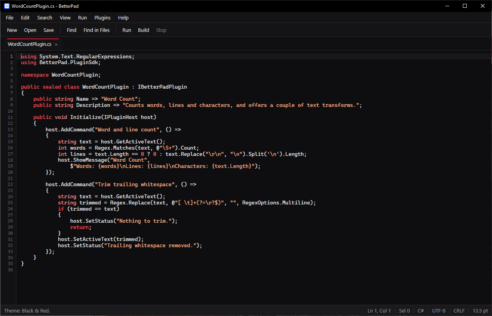
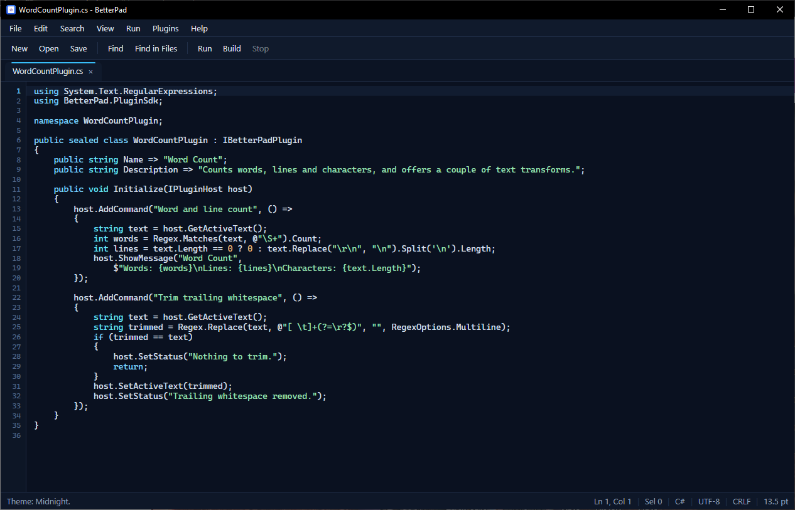
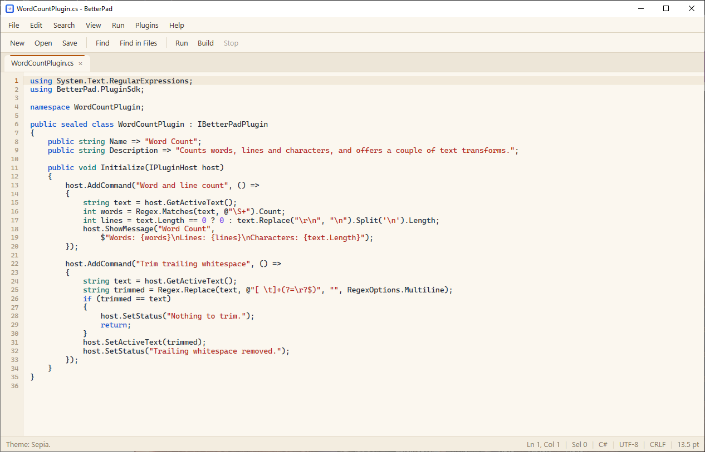
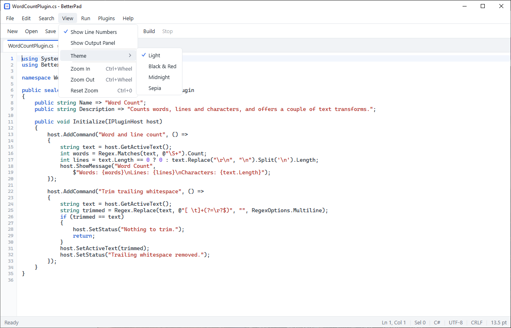

# BetterPad

A tabbed text and code editor for Windows. Native WPF on .NET 10, no Electron, no accounts, no telemetry, no update pings. Open files, edit them, search a folder, run a script with the tools already installed on the machine.



## Download

Grab `BetterPad-1.0.0-win-x64.zip` from the [Releases page](https://github.com/jovandonev2009-wq/BetterPad/releases/latest) and unzip it anywhere. The build is self-contained, so the .NET runtime is included. It is not code-signed, so Windows SmartScreen may ask for confirmation the first time.

## Features

- Tabbed editing with a dot for unsaved changes. Plain text, source code, and rich text (RTF) tabs.
- Syntax highlighting driven by JSON rule files you can edit, for C/C++, C#, CSS, INI, JavaScript, JSON, Python, SQL, Tiny, and XML.
- A line-number gutter, zoom, and a configurable tab size.
- Find and replace with regex, match case, and whole-word options.
- Find in Files: recursive folder search with file masks and regex. Double-click a result (or press Enter) to open that file at that line.
- Plugins are DLLs in a folder. They can add commands to the Plugins menu.
- Run the current file with the local interpreter or compiler, and read its output in a panel at the bottom.
- Tiny, a small built-in language. `.tiny` files run in-process, so they need no external tools.
- Four themes: Light, Black & Red, Midnight, Sepia. The dark ones also recolor syntax tokens.
- Errors and confirmations use the app's own modal dialogs; everyday state goes in the status bar.

## Requirements

- Windows 10 or 11, x64. WPF does not run anywhere else.
- The .NET 10 SDK only to build from source. The release download includes the runtime.
- Optional, only for Run/Build: `dotnet`, `python`, `node`, `powershell`, `cmd`.

## Build and run

From the repository root:

```bat
dotnet build BetterPad.slnx
```

Then run the exe:

```bat
src\BetterPad\bin\Debug\net10.0-windows\BetterPad.exe
```

Or use `dotnet run`:

```bat
dotnet run --project src\BetterPad\BetterPad.csproj
```

The solution has five projects:

| Path | What it is |
| --- | --- |
| `src\BetterPad` | The WPF application. |
| `src\BetterPad.Language` | The Tiny language: lexer, parser, interpreter. Plain .NET. |
| `src\TinyLang` | Console runner for Tiny programs. |
| `src\BetterPad.PluginSdk` | The plugin interface shared by the app and plugins. |
| `samples\WordCountPlugin` | A sample plugin: word and line count, trim trailing whitespace. |

## Settings and local data

Everything user-editable is under `%AppData%\BetterPad`:

- `syntax\*.json`: the syntax rules. They are copied from the app's bundled rules on first run, and existing files are never overwritten, so your edits stick.
- `plugins\*.dll`: plugins. Loaded at startup and from *Plugins > Reload Plugins*.
- `settings.json`: window size and position, font size, tab size, line-number visibility, last folders, and the active theme.

*Help > Syntax Rules Folder* and *Plugins > Open Plugins Folder* open these folders for you. After changing a rule file, use *Help > Reload Syntax Rules*.

## Themes

Pick one from *View > Theme*. The change applies right away to the toolbar, menus, tabs, dialogs, search results, editor, and gutter, and the native title bar follows along on Windows 10 and 11.

Light and Sepia use the colors from the syntax rule files. Black & Red and Midnight bring their own token palette so keywords, strings, and comments stay readable on a dark background. The last choice is saved in `settings.json`.

<p>
  
  
</p>
<p>
  
  
</p>

## Syntax rules

A rule file is a plain JSON object:

```json
{
  "name": "Python",
  "extensions": [".py", ".pyw"],
  "caseSensitive": true,
  "lineComments": ["#"],
  "blockComments": [],
  "strings": ["\"\"\"", "'''", "\"", "'"],
  "preprocessor": null,
  "keywords": ["def", "class", "return"],
  "types": ["int", "str", "list"],
  "colors": {
    "default": "#1F2937",
    "keyword": "#0B57D0",
    "type": "#0F766E",
    "string": "#B42318",
    "comment": "#15803D",
    "number": "#7C3AED",
    "preprocessor": "#6B7280"
  }
}
```

Rules are matched by file extension. If nothing matches, the file opens as plain text.

## Plugins

A plugin is a .NET class library that references `BetterPad.PluginSdk` and implements `IBetterPadPlugin`:

```csharp
public sealed class MyPlugin : IBetterPadPlugin
{
    public string Name => "My plugin";
    public string Description => "Does something local.";

    public void Initialize(IPluginHost host)
    {
        host.AddCommand("Do something", () => host.SetStatus("Done"));
    }
}
```

`IPluginHost` gives you the active file path and text, insert and replace, a modal message, menu commands, and the status text. Plugins run in-process with full trust, so only load DLLs you built or otherwise trust.

Build the sample:

```bat
dotnet build samples\WordCountPlugin\WordCountPlugin.csproj
```

The app also copies the sample DLL to `sample-plugins` next to the executable. Copy it into `%AppData%\BetterPad\plugins` to see its commands in the menu.

## Run and Build

*Run* (`F5`) launches the current file with a local tool:

| File | Tool |
| --- | --- |
| `.py` | `python` |
| `.js`, `.mjs`, `.cjs` | `node` |
| `.ps1` | `powershell -File` |
| `.bat`, `.cmd` | `cmd /c` |
| `.csproj` | `dotnet run --project` |
| `.cs` inside a project folder | `dotnet run --project` |
| `.tiny` | the built-in Tiny interpreter |

*Build* (`Ctrl+Shift+B`) runs `dotnet build` on a `.csproj`, `.sln`, or the project found in the current file's folder. Output and errors go to the output panel. *Stop* kills the whole process tree. Files with other extensions report that no local runner is configured; Tiny files report that there is nothing to build.

## Tiny

Tiny lives in `src\BetterPad.Language` and runs in-process, so `.tiny` files need no compiler. Open one, press *Run* (`F5`), and the output appears in the panel. Errors open a dialog with the line and column. *Stop* cancels the program.

```tiny
// Comments run to the end of the line.
fn fib(n) {
    if (n < 2) {
        return n;
    }
    return fib(n - 1) + fib(n - 2);
}

let i = 0;
while (i < 10) {
    print("fib(" + i + ") = " + fib(i));
    i = i + 1;
}
```

The language in short:

- Values are numbers (`1`, `2.5`), text (`"hello"`, with `\n`, `\t`, `\"`, `\\` escapes), and booleans. There is no null.
- `let name = value;` declares a variable, `name = value;` reassigns it. Variables are block-scoped, and declaring the same name twice in one block is an error.
- Operators: `+ - * / %`, comparisons `== != < <= > >=`, logic `&& || !`, and parentheses. `+` concatenates when either side is text. Conditions and logic want real booleans; Tiny does not treat numbers or text as true/false.
- Control flow: `if (condition) { ... } else if (condition) { ... } else { ... }` and `while (condition) { ... }`.
- Functions: `fn name(a, b) { return value; }`, top-level only, in any order. Recursion works. Every function has to return a value; falling off the end is an error.
- `print(value)` writes one line. Text concatenation is how you format things.
- Statements end with `;` and blocks use `{ }`.

A sample lives at `samples\tiny\hello.tiny`.

There is also a standalone console runner, which is plain .NET and works outside the editor:

```bat
dotnet build src\TinyLang\TinyLang.csproj
src\TinyLang\bin\Debug\net10.0\TinyLang.exe samples\tiny\hello.tiny
```

It prints errors as `file:line:column: message` and exits with code 1.

A run stops after 5,000,000 statements or 1,000 nested calls. Tiny has no lists, dictionaries, classes, or input yet.

## Shortcuts

| Action | Keys |
| --- | --- |
| New / Open / Save / Save As | Ctrl+N / Ctrl+O / Ctrl+S / Ctrl+Shift+S |
| Close tab | Ctrl+W |
| Find / Replace | Ctrl+F / Ctrl+H |
| Find next / previous | F3 / Shift+F3 |
| Find in Files | Ctrl+Shift+F |
| Run / Build / Stop | F5 / Ctrl+Shift+B / Shift+F5 |
| Zoom in / out / reset | Ctrl+Wheel / Ctrl+Wheel / Ctrl+0 |

## Limitations

- Windows only. A macOS or Linux build would need a separate front-end, not this one.
- No debugger. Run and Build start local tools and show their console output; there are no breakpoints or stepping.
- Find/Replace, Find in Files, and plugin text operations work on code tabs. Rich-text tabs are RTF and are skipped.
- Find in Files reads text files up to 5 MB, skips files that look binary, and shows at most 10,000 matching lines per scan.
- The editor keeps a transparent TextBox over a custom renderer. Large files stay usable thanks to debounced background tokenization, but the text is not virtualized.

## License

MIT. See [LICENSE](LICENSE).
